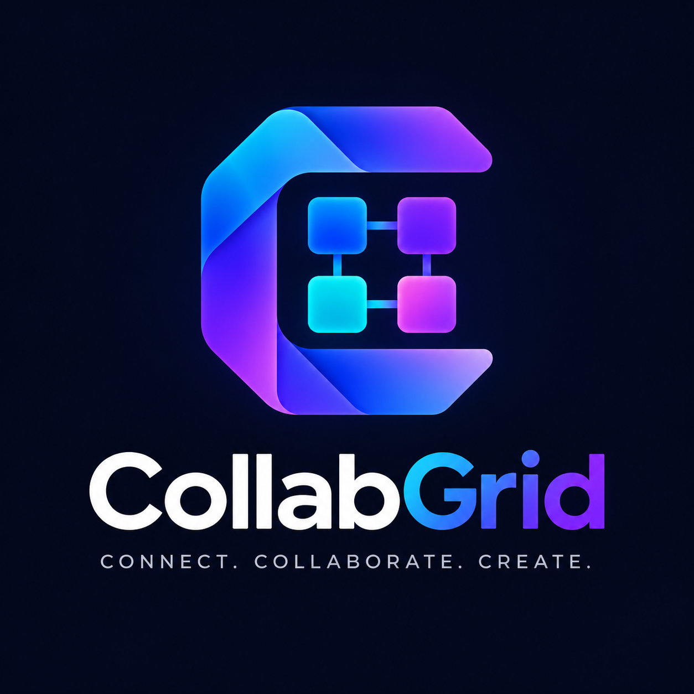

<div align="center">



# CollabGrid

**Next-Generation Real-Time Agile Workspace & Team Collaboration Platform**

*Connect. Collaborate. Create.*

[](https://react.dev/)
[](https://vitejs.dev/)
[](https://tailwindcss.com/)
[](https://nodejs.org/)
[](https://expressjs.com/)
[](https://mongoosejs.com/)
[](https://developer.mozilla.org/en-US/docs/Web/API/WebSockets_API)
[](LICENSE)

</div>

---

## 📖 Table of Contents

- [Overview](#-overview)
- [Key Features](#-key-features)
- [Technology Stack](#-technology-stack)
- [System Architecture](#-system-architecture)
- [Repository Structure](#-repository-structure)
- [Getting Started](#-getting-started)
  - [Prerequisites](#prerequisites)
  - [Backend Setup](#1-backend-setup)
  - [Frontend Setup](#2-frontend-setup)
- [Environment Variables](#-environment-variables)
- [API & WebSocket Specification](#-api--websocket-specification)
- [Automated Testing](#-automated-testing)
- [Contributing & License](#-contributing--license)

---

## 🌟 Overview

**CollabGrid** is a full-stack, enterprise-grade project management and real-time collaboration application designed for agile teams. It combines modern Kanban workflow management, live collaborative whiteboards, multimedia chat rooms, team workspace invitations, and milestone calendar scheduling into a single, cohesive, modern interface.

Built with **React 19**, **Vite**, **Tailwind CSS**, and a function-based MVC **Node.js/Express** backend with **MongoDB (Mongoose)** and native **WebSockets**, CollabGrid provides high performance, sub-millisecond synchronization, and responsive UX across all screen sizes.

---

## ✨ Key Features

### 📋 1. Kanban & Task Management
- **Smooth Drag-and-Drop**: Fluid card movement across *To Do*, *In Progress*, and *Done* columns powered by `@hello-pangea/dnd`.
- **Dual View Modes**: Switch seamlessly between interactive **Kanban Board** and high-density **List Table** views.
- **Search & Advanced Filtering**: Filter tasks by title, description, priority (*High*, *Medium*, *Low*), status, and assigned project.
- **Due Date Tracking & Overdue Warnings**: Visual indicators and badges for upcoming deadlines and overdue milestones.
- **Modal CRUD Operations**: Create, edit, inspect, and delete tasks with instant optimistic UI updates.

### 🎨 2. Real-Time Collaborative Whiteboard
- **Live Canvas Synchronization**: Multi-user drawing broadcasted instantly over WebSockets.
- **Active Member Presence**: See who is currently connected and drawing in real-time.
- **Rich Drawing Tools**: Adjustable brush widths, HEX color picker, and customizable whiteboard canvas background.
- **Undo, Clear & PNG Export**: Instant stroke undo, canvas reset, and one-click high-resolution PNG export for design artifacts.
- **Persistent State**: Canvas strokes and background states are automatically saved to MongoDB.

### 💬 3. In-Project Multimedia Chat
- **Real-Time Messaging**: WebSocket-powered chat dedicated to each workspace.
- **Message Lifecycle**: Edit and delete messages with live updates across all active team members.
- **File Attachments & Voice Notes**: Upload and share project documents and voice recordings.

### 👥 4. Team Workspaces & Invitations
- **Role-Based Ownership**: Project leaders can invite registered users by email or username.
- **Real-Time Invitations**: Instant invitation delivery, pending badges, and accept/decline flows.
- **Dedicated Project Workspaces**: Isolate tasks and live canvases per project.

### 📅 5. Schedule & Calendar Matrix
- **Weekly Schedule Matrix**: Integrated 7-day schedule grid on the dashboard for scheduled tasks.
- **Full Interactive Calendar**: Month, week, and day views powered by FullCalendar.

### 🔐 6. Secure Authentication & Notifications
- **JWT Authentication**: Secure Bearer tokens with automated refresh and request interceptors.
- **Password Security**: Passwords hashed using `bcryptjs` with configurable salt rounds.
- **3-Step Password Reset**: OTP verification flow with optional SendGrid integration.
- **Notification Hub**: Real-time alerts for project invites and updates with bulk-read and clear actions.

---

## 🛠 Technology Stack

### Frontend
- **Framework**: [React 19](https://react.dev/) + [Vite](https://vitejs.dev/) (ES Modules)
- **Styling**: [Tailwind CSS 3.4](https://tailwindcss.com/) + PostCSS + Autoprefixer
- **Drag & Drop**: [@hello-pangea/dnd](https://github.com/hello-pangea/dnd)
- **Calendar**: [FullCalendar](https://fullcalendar.io/)
- **HTTP Client**: [Axios](https://axios-http.com/) (Centralized API client with auth interceptors)
- **State Management**: React Context API (`AuthContext`) + Custom Hooks (`useAuth`)

### Backend
- **Runtime**: [Node.js](https://nodejs.org/) (ES Modules)
- **Server Framework**: [Express.js 4](https://expressjs.com/) (Function-based MVC architecture)
- **Database**: [MongoDB](https://www.mongodb.com/) via [Mongoose 9](https://mongoosejs.com/)
- **Real-Time Engine**: [ws](https://github.com/websockets/ws) (Native WebSockets for Chat & Whiteboard)
- **Authentication**: [jsonwebtoken](https://github.com/auth0/node-jsonwebtoken) + [bcryptjs](https://github.com/dcodeIO/bcrypt.js)
- **File Uploads**: [Multer](https://github.com/expressjs/multer)
- **Email Service**: [@sendgrid/mail](https://github.com/sendgrid/sendgrid-nodejs) (Optional)

---

## 🏗 System Architecture

CollabGrid follows a decoupled, function-based MVC pattern on the backend and a modular component hierarchy on the frontend:

```text
┌─────────────────────────────────────────────────────────────┐
│                       React 19 Frontend                     │
│  AppLayout ── Header / Sidebar / MobileDrawer               │
│  Pages: Dashboard / Tasks / Projects / Collaboration / Notifs│
│  Services: Centralized Axios Client (Auth Token Interceptor) │
└──────────────────────▲───────────────────────────────▲──────┘
                       │ HTTP REST                     │ WebSockets
                       │ (/api/*)                      │ (/api/ws/*)
┌──────────────────────▼───────────────────────────────▼──────┐
│                    Express.js Backend (MVC)                 │
│  Routes ──► Middlewares (Auth / Validation / CORS)           │
│  Controllers ──► Services ──► Repositories                  │
│  WebSocket Server (Chat & Whiteboard Channels)              │
└──────────────────────────────▲──────────────────────────────┘
                               │ Mongoose
┌──────────────────────────────▼──────────────────────────────┐
│                  MongoDB Atlas / Local DB                   │
│  Collections: Users, Tasks, Projects, Invites, Chat, Board │
└─────────────────────────────────────────────────────────────┘
```

---

## 📁 Repository Structure

```text
Kanban-board/
├── backend/
│   ├── src/
│   │   ├── config/             # Database (Mongoose), environment & SendGrid config
│   │   ├── controllers/        # Express route handler functions
│   │   ├── middlewares/        # JWT auth, error handling & 404 middlewares
│   │   ├── models/             # Mongoose schemas & data models
│   │   ├── repositories/       # Database abstraction layer
│   │   ├── routes/             # Modular Express routers
│   │   ├── services/           # Business logic & WebSocket handlers
│   │   ├── utils/              # Security, crypto, JWT & validator helpers
│   │   └── server.js           # Server bootstrap & WebSocket router
│   ├── tests/                  # Automated integration & unit tests (node:test)
│   ├── .env.example            # Backend environment template
│   └── package.json
│
├── frontend/
│   ├── public/
│   │   └── logo.png            # CollabGrid official branding asset
│   ├── src/
│   │   ├── components/
│   │   │   ├── auth/           # AuthForm, ForgotPassword
│   │   │   ├── chat/           # ChatSidebar (WebSocket chat)
│   │   │   ├── common/         # LoadingSpinner, EmptyState
│   │   │   ├── dashboard/      # DetailsModal
│   │   │   ├── layout/         # AppLayout, Header, Sidebar, MobileSidebar
│   │   │   ├── whiteboard/     # Whiteboard (Live HTML5 canvas)
│   │   │   ├── CalendarPage.jsx
│   │   │   ├── CustomSelect.jsx
│   │   │   └── FeatureModal.jsx
│   │   ├── context/            # AuthContext (Session state & token sync)
│   │   ├── hooks/              # useAuth hook
│   │   ├── pages/              # DashboardPage, TasksPage, ProjectsPage, CollaborationPage, etc.
│   │   ├── services/           # Axios client & feature API services
│   │   ├── App.jsx             # Clean root router & view coordinator
│   │   ├── index.css           # Tailwind CSS directives
│   │   └── index.jsx           # React DOM root entry
│   ├── .env.example            # Frontend environment template
│   ├── package.json
│   └── vite.config.js
│
├── .gitignore
└── README.md
```

---

## 🚀 Getting Started

### Prerequisites

- **Node.js**: v18.0.0 or higher ([Download](https://nodejs.org/))
- **npm**: v9.0.0 or higher
- **MongoDB**: Local MongoDB instance or free [MongoDB Atlas](https://www.mongodb.com/atlas) cluster

---

### 1. Backend Setup

1. **Navigate to the backend directory:**
   ```bash
   cd backend
   ```

2. **Install dependencies:**
   ```bash
   npm install
   ```

3. **Configure environment variables:**
   Copy `.env.example` to `.env`:
   ```bash
   cp .env.example .env
   ```
   *Edit `.env` to configure your MongoDB connection string and JWT secret:*
   ```env
   PORT=5000
   FRONTEND_URL=http://localhost:3000
   MONGO_URL=mongodb://127.0.0.1:27017/collabgrid
   DB_NAME=collabgrid
   JWT_SECRET=super_secure_jwt_secret_change_me
   ```

4. **Run the backend tests:**
   ```bash
   npm test
   ```

5. **Start the backend server:**
   - **Development mode (with nodemon):**
     ```bash
     npm run dev
     ```
   - **Production mode:**
     ```bash
     npm start
     ```
   *Backend will start on `http://localhost:5000` with WebSockets available at `ws://localhost:5000/api/ws`.*

---

### 2. Frontend Setup

1. **Open a new terminal and navigate to the frontend directory:**
   ```bash
   cd frontend
   ```

2. **Install dependencies:**
   ```bash
   npm install
   ```

3. **Configure environment variables (Optional for local dev):**
   ```bash
   cp .env.example .env
   ```
   *By default, Vite proxies requests to `http://localhost:5000`.*

4. **Start the frontend development server:**
   ```bash
   npm run dev
   ```

5. **Open your browser:**
   Navigate to **`http://localhost:3000`** (or the URL shown in the terminal).

6. **Create a production build:**
   ```bash
   npm run build
   ```

---

## ⚙️ Environment Variables

### Backend (`backend/.env`)

| Variable | Type | Default | Description |
| :--- | :--- | :--- | :--- |
| `PORT` | Number | `5000` | Port on which the Express server listens |
| `FRONTEND_URL` | String | `http://localhost:3000` | Allowed CORS origin & base URL for emails |
| `MONGO_URL` | String | `mongodb://127.0.0.1:27017/collabgrid` | MongoDB connection URI (Local or Atlas) |
| `DB_NAME` | String | `collabgrid` | Target database name |
| `JWT_SECRET` | String | *Required* | Secret key for signing and verifying JWTs |
| `JWT_ALGORITHM` | String | `HS256` | JWT signing algorithm |
| `JWT_EXPIRATION_HOURS` | Number | `72` | Token validity duration |
| `SENDGRID_API_KEY` | String | `""` | *(Optional)* SendGrid API key for transactional emails |
| `FROM_EMAIL` | String | `no-reply@collabgrid.com` | Sender email address for outgoing emails |

### Frontend (`frontend/.env`)

| Variable | Type | Default | Description |
| :--- | :--- | :--- | :--- |
| `VITE_BACKEND_URL` | String | `http://localhost:5000` | Backend API base URL when hosted on a different origin |

---

## 🔌 API & WebSocket Specification

### REST API Endpoints

| Method | Endpoint | Description | Auth Required |
| :--- | :--- | :--- | :---: |
| `GET` | `/api/health` | Health check & system status | ❌ |
| `POST` | `/api/auth/register` | Register a new user | ❌ |
| `POST` | `/api/auth/login` | Authenticate and obtain JWT token | ❌ |
| `GET` | `/api/auth/me` | Fetch authenticated user profile | ✅ |
| `POST` | `/api/auth/forgot-password` | Request password reset OTP | ❌ |
| `POST` | `/api/auth/verify-otp` | Verify 6-digit OTP | ❌ |
| `POST` | `/api/auth/reset-password` | Set new password with verified OTP | ❌ |
| `GET` | `/api/dashboard/stats` | Get workspace task and project statistics | ✅ |
| `GET`, `POST` | `/api/tasks` | List all tasks or create a new task | ✅ |
| `PUT`, `DELETE`| `/api/tasks/:id` | Update or delete a task | ✅ |
| `GET`, `POST` | `/api/projects` | List projects or create a new project | ✅ |
| `GET`, `PUT`, `DELETE`| `/api/projects/:id` | Project details, update, or delete | ✅ |
| `GET` | `/api/collaboration/projects`| Projects owned or joined by user | ✅ |
| `POST` | `/api/collaboration/invite` | Send team workspace invite | ✅ |
| `POST` | `/api/collaboration/invite/:id/accept` | Accept workspace invitation | ✅ |
| `GET`, `POST` | `/api/whiteboard/:projectId` | Fetch or save whiteboard canvas state | ✅ |
| `GET` | `/api/notifications` | Fetch user notifications | ✅ |
| `POST` | `/api/notifications/:id/read` | Mark single notification as read | ✅ |
| `DELETE` | `/api/notifications/read/all` | Delete all read notifications | ✅ |

### WebSocket Endpoints

| Protocol | Path | Query / Token | Description |
| :--- | :--- | :--- | :--- |
| `WS` | `/api/ws/chat/:projectId` | `?token=<JWT>` | Real-time chat channel for the project |
| `WS` | `/api/ws/whiteboard/:projectId` | `?token=<JWT>` | Real-time live canvas strokes & presence |

---

## 🧪 Automated Testing

The backend includes an integrated test suite using Node.js's native test runner (`node:test`):

```bash
cd backend
npm test
```

### Covered Test Suites:
1. **Authentication & Security Utilities**:
   - Password hashing and verification via `bcryptjs`.
   - JWT generation, sub claims, and expiration.
   - Cryptographically secure 6-digit OTP generation and validity checks.
   - User document sanitation (stripping password hashes from output).
   - Input validators for registration and login.
2. **Health and System Routes**:
   - HTTP server lifecycle.
   - `GET /api/health` 200 verification.
   - 404 response handling for unknown routes.
3. **Data Models and Document Formatters**:
   - Task default schemas and title validation.
   - Project defaults, theme colors, and collaborators.
   - Calendar date and time formatter integrity.

---

## 📄 Contributing & License

Contributions, issues, and feature requests are welcome! Feel free to check the issues tab if you want to contribute.

This project is licensed under the **MIT License**.
